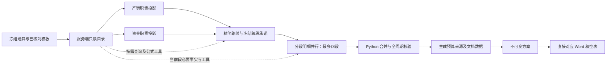

# 经营方案生成审查与重构（2026-10-15）

## 分段资料聚合容量修复

用户反馈 `windows.1.references 选择的资料超过分段上下文容量`。代码在 `PlanningKnowledge.project` 返回任意待查 ID 时立即终止，混淆了“初始投影未装入”和“规范资料无法读取”；原有分段查询工具尚未运行就失败。初始条件较多、路线选择多项来源时，即使每条资料均可完整查询，也能触发此错误。

新增 `project_handoff`：保留初始投影22000字符边界，按选中 ID 将未装入的完整记录补入最多24项/12000字符的 `reference_evidence`；其余 ID 留在有界待查清单，由分段使用原有 `planning_lookup` 分批读取。同轮可发多个查询，不新增强制模型往返。发送的记录才登记已读，原值、单位、状态及来源不截断、不提升；未知/跨题引用拒绝，单条资料既装不进初始投影、也无法完整查询时仍返回具体分段/ID诊断。真实模型累计输入、五轮、子额度、总额度、截止时间及一次定位修正保持约束。

新增5项回归，73项相关后端检查与修改模块 Ruff 通过。覆盖初始资金保留、补充包无重复/原值完整、剩余资料未读标记、原生多查询后的16期生成、成功缓存重放、隔离SQLite保存及Word重开、未读取来源持续失败和真正超大记录诊断。未调用真实模型、未读取或改写运行数据库/预设、未重启或部署服务；验证支持这一容量缺口的修复，不能保证所有真实模型输出或完整经营可行性。

本次以工作区已有修改为起点，保留读题、不可变方案保存、任务取消、模型预设和导出器。当前生成入口是 `application/planning_pipeline.py` 的 `ParallelPlanningGenerator`，由 Web 工作流调用；旧 Solver 的专属补丁和协作类作为兼容路径保留，不参与新 Web 生成。

## 2026-10-16：可理解的引用问题与赛道2规程（solver-20）

用户报出的工资依据编号不在当前题目目录，按字符串也找不到可信候选。不能要求用户猜 fact ID，也不能据此断言缺少工资参数。本轮把诊断保留为结构化的期间、行动说明、对象、字段及未知引用；已有一次修正按真实行动对象及目录名称补传最多12项相关事实（资料包仍最多24项/12000字符），供模型核对。没有确定性替换、删除未知引用或新增重试。人工重试重新发送相同对象的完整规范记录，只为实际发送内容登记已读，避免再次因为资料未传递而多请求一轮。

窗口现在解释“生成操作未能关联题目依据”，列出第几年第几季及工资等业务说明，明确不代表题目缺资料，也不需要用户查找/填写内部编号。推荐选项为“重新核对题目依据并修正”，允许空说明；原始字段、拼接 ID、相似候选折叠在诊断详情中。模型修正继续接收完整技术诊断。未读取来源与未知来源保持不同错误码，原校验没有放宽。

已读取用户提供的《附件3：数智决策对抗赛（赛道2）规程.docx》，SHA256 `bd8b043179e48234d606410c70b56615cd7ca9f9a146d64b0b21844ced5f52d5`。依据第五节及各岗位规则制作包内提示词摘要；运行不读取 sample 或此DOCX。公共指引说明适用范围和来源，产销、资金、路线、分段/短周期只接相应职责条款，各完整阶段提示词约3055–4255字符，没有把原文整体塞入每个请求。

规程核对重点：

- 关闭数智化、碳达峰/碳中和，不考财务报表；现金和期末权益仍关系破产，不能套含关闭项目的候选计分公式。
- 每单申报量不高于30%，竞单报价下限为参考价90%，入围还需对应市场/ISO条件；产品资格可在申报时尚未取得，开产前必须取得。一次广告窗口、实际分单与完整合同交付分开规划。
- 新聘员工下季查看到岗，薪资影响入职；可拟定具体offer人数和工资，不能因尚未发生便全部留空。按季度月薪×3，开产计件工资另付，培训占用人员。
- 下单原料不付款，到货后形成应付并按账期结算；预算划拨非重复现金付款，基线确认后不能回改。周年维修/税费自动现金扣除、折旧非现金，避免重复支付。
- 区分不变参数表与变动案例。案例企业、初始资金、产品、价格和工资不植入当前题目；正式题目明确覆盖优先，未进入冻结来源的口径仅作情景，不自建正式引用。违约40%/20%、班次表与翻倍文字、涨薪算例、未收货/未付款原料上限存在争议，不静默裁决。规程未给完整最终计分公式，不补造。

验证：238项后端检查通过，新增4项覆盖同类第6/8期未知工资ID、真实工资记录补传、空白人工答复只重试问题段、分职责提示词容量/案例不污染题目。正常16期七次请求，一次引用修正八次；持续错误后人工直接重查九次，均为受控响应。17项前端交互检查、类型检查/构建与修改模块Ruff/格式检查通过，静态产物同步。本轮未调用真实模型、未改运行数据或模型预设、未重启/部署服务；本轮规则更新是提示词核对指引，不代表已经实现完整平台规则仿真。用户暂存的规程文件不纳入代码提交。

## 2026-10-16：现金单位与人工处理（solver-19）

本轮工作区起点干净，现有提交为 `6372d12`。保留已有分批上下文交接及其5项回归。审查发现两项直接关联问题：分段限额用单位字符串比较，导致元/万元等可精确换算的金额也被拒绝；现金折叠则跳过单位不同的付款，可能漏检同一币种的现金短缺。两处现在共用 `domain/money.py` 的 Decimal 换算，只处理明确单位，不推断汇率或把每月费率当总额。行动原金额和单位保持，比较时换算，超限仍拒绝。公共、路线、分段提示词区分总额、单价、月费及支付频率。

生成错误经过原有有限自动修正后，支持进入 `needs_input` 并持有结构化 intervention。问题包含任务、具体行动、金额、原单位、限额和选项。可人工解释的局部金额允许用户明确确认单位（不改数值、不改共享承诺或计算证据），其说明进入方案假设；也可填写说明后仅重新请求问题任务，取消或在额度不足时开始新任务。恢复仍完整检查引用、实体、时序、期间、现金和限额，不能选择跳过校验。

暂停通过异常退出当前后台执行，不阻塞线程等待人类。Runner保留同一任务的继续操作和控制对象，答复后重新入队；规划器复用私有运行响应，未验证结果不写成功缓存。原任务调用计数保持，人工等待只延后相同预算的截止时间。API校验问题ID、选项、文本长度、题目版本及输入修订；重复答复、过期问题和不相干任务拒绝。删除引用文件/项目或取消任务会清理待答问题。服务重启不能恢复内存继续点，启动时明确标记需重试并移除失效问题。

Web复用统一模态组件：自动展示选项、自由文字及金额列表；不自动提交，关闭后可从任务记录重开，轮询不会反复弹出同一问题，刷新后能找回当前问题。待处理任务阻止重复生成。类型检查和构建通过，静态文件同步。

验证：234项后端定向检查通过，其中8项新回归覆盖精确金额换算、换算后超限、现金短缺、同任务人工单位确认零新增模型请求、只重试问题段、单工作线程仍能执行其它任务、取消/服务恢复，以及隔离HTTP生成→提问→答复→保存16期方案与重复答复拒绝。16项前端交互检查通过（含3项新弹窗测试），修改模块Ruff和前端格式检查通过。均使用受控模型及隔离数据库；本轮没有真实模型请求、运行数据修改、服务重启或部署，不能保证真实模型语义或完整经营可行性。

## 系统审查与 solver-18

此次只读核对现场失败记录和冻结题目。用户报出的两个 ID 实际对应 R4 送货期和传统线折旧年限，不能据任务名称解释为初始资本及管理费。旧流程把路线的下游资料选择也当成“必须已读的经营依据”，一次修正选入新的合法 ID 就会再次失败。另一方面，各段继承了上游全部已读标记，却未必收到这些记录，存在反向放松校验的问题。

本轮将两者明确分开：路线选择当前题目资料，由程序发送到相应分段；行动引用仍要求实际收到内容。`planning_handoff.py` 统一来源和计算传递，原生工具的共享引用枚举按可见目录刷新，避免把完整题目目录塞进 Schema。分析、路线与分段使用各自职责提示词，计算结果可显示和查询；单项与批次执行保留 Decimal、单位、情景及来源边界。

现场空表需求投影原占 12210 字符，产销初始仅装入12项事实。去重参数目录为2591字符，新的实际请求装入38项事实且仍控制在22000字符内；这是请求内容对比，不是性能基准。完整模板说明与依赖按工作表查询，预算仍在生成阶段完成。实际 API 又暴露待查引用清单在正文装满后追加导致超限，现在清单和元数据先计入容量。

实际分段响应还暴露缺少情景条件的问题：模型将“实际合同及资源成立时执行”写作 gap + null，旧诊断只报字符串错误，无法完成一次修正。新增 scenario 保留明确前提，引用/运算符/比较值为空；对应说明进入方案假设，不能冒充已成立事实。明确未知的引用仍拒绝。多个行动错误一次汇总到期间/key，近似 ID 仅提供核对候选，不自动替换。情景融资/收款不填平确定支出。通用经营仿真仍缺失，条件不等于仿真已验证。

随后一轮真实分段修正省略 condition 中的可空字段，导致无意义的结构失败；现在编译边界补 null，保留条件种类和引用。工具先前只给公式名枚举，参数写错后仅返回笼统错误；现在直接给准确签名，诊断列出缺少/多余参数，便于下一批仅重试失败项。新决策中 payment 标为 cost 会归入现金支付，不能遗漏在现金折叠之外。路线提示词进一步要求跨段人员和设备只配置一次，拟定数量必须结构化；未知真实参数仍不补造。

临时网关错误之后原生工具对话原先被丢弃，重试只能看到原投影，额度却已消耗。现通过单次恢复调用范围内的状态保留消息、工具结果及计算，重试不重新查询；状态不跨任务共享，每次请求继续计数，五轮及总截止时间不重置。独立分析完成后保存已校验检查点，后续路线失败不要求重跑分析；未通过全局检查的行动不发布。

截至本轮定向回归：220项后端检查通过，覆盖新流程、旧行动契约、预算、HTTP、持久化、工具和恢复。前端未修改。用户本轮明确授权本机/API调试，真实请求使用只读题目快照和隔离配置副本，没有修改运行数据、预设或重启原服务。首次真实测试完成两项分析后发现容量错误；复用分析继续后，路线与四段输出均返回，但合并暴露条件问题。最终联调结果将在验证结束后补记，不能将上述中间结果宣称完整生成成功。

## 路线引用交接修复

“路线分段约束引用未读取资料”可由两处代码缺口复现：职责投影按整实体装入，实体超大时会连同分析明确引用的字段一起省略；路线失败诊断没有列出未读 ID，一次修正只重发原投影，无法确定性补齐。另外，路线修正完成后的缓存只保存最后一次工具访问，前次读取会在缓存重放时丢失。

投影现在先放完整的显式引用记录和初始条件，再在剩余容量内补充实体资料；规范记录的原值、单位、状态和来源保持。路线校验区分未知与未读引用，诊断提供分段字段和具体 ID。既有一次修正通过 `reference_batch` 补入本题目录中的真实记录，最多24项/12000字符，只为实际发送的条目登记已读；未知、跨题或超大无法传输的记录不会放行。路线成功缓存保存累计工具读取和修正补取记录。正常流程不增加模型请求，修正上限和调用/截止时间仍生效。

新增10项回归，164项相关后端检查与修改模块 Ruff 通过。覆盖大型实体中的目标字段、规则优先、分析交接、已知未读引用的精确补取、两种缓存继承、未知引用拒绝及容量边界。隔离应用通过原生工具受控响应完成上传→读题→修订→16期求解，路线补取后在八次求解请求内保存，假设状态未提升。未进行真实付费联调，未改运行数据或重启现有服务；不代表所有现场语义问题已被证明消除。

## 分段调用额度修复

分段规划需要两次分析、一次路线和四次分段提交，正常路径就有七次请求。原实现仍将所有任务别名到同一个八次额度，因此两段各修正一次至少九次请求时必然失败；估算式 `reserved_model_calls` 也无法形成并发任务之间的实际额度隔离。

现在 `planning_budget.py` 在调用前按已知任务预分配公平子额度，各子额度合计不超过 `ERP_SOLVER_MAX_MODEL_CALLS`（默认32、可设1–256）。已有 `ERP_TASK_MAX_MODEL_CALLS=8` 继续限制普通任务，并作为规划子额度的最大值；预算匹配根据工作表数预留。父子额度都检查上限，嵌套包装只扣一次；每次原生工具往返、重试、截断扩容、修正都计数。工具循环以当前子额度提前收束，为提交与修正留空间。总截止时间仍从整次求解开始计算，默认900秒，不按分段重置。显式设置求解总额为8仍受严格限制，不足必需任务数则在调用模型前报配置错误。预算配置写入任务模型池快照，不改运行预设；耗尽诊断区分子额度和求解总计。

新增10项回归，178项后端定向检查通过，修改模块 Ruff 通过。两段修正九次请求成功；四段均执行批量计算和查询、其中两段修正，十七次模型请求成功且父额度计数完全相同。覆盖子额度不可抢占、严格八次的隔离应用、调度不重置额度、嵌套计数、预算匹配预留、配置与统一截止时间，并验证模型预设/调度/恢复兼容。受控响应不代表真实模型质量或无限重试能力；未付费联调，未改运行数据或重启现有服务。

## 分段并行生成（solver-17）

用户反馈单个统筹任务承载全部期间，并在 `fee02` 上发生 FinanceDetails 字段不匹配。原行动 Schema 的 kind 与 details 是两个独立枚举/联合，payment 可以在模型 Schema 下匹配到其它类型的详情，而 Python 解码器要求财务详情。现在同一决策 Schema 通过关联分支约束 kind/details，只有契约允许的空关联字段可补 null；缺少真实实体或出现错误字段仍明确定位并有限修正。

超过四期的流程改为：产销与资金分析并行 → 精简路线/跨段承诺 → 最多四段逐期明细并行 → Python 合并与全周期校验。16 期分为四个连续四期段；其它周期根据实际总期数均衡切分，不写死经营年数。路线只返回必要跨段行动、每段引用/约束和可选支出限额，不生成全量操作卡。各段 Schema 只含分配期间，保留有界事实投影与只读查询目录，不重复原职责分析或完整历史计划；每段预留 8000 输出 Token。

跨段依赖只引用冻结共享行动，共享承诺只插入一次，局部行动 key 由 Python 加段前缀。程序合并后检查依赖、真实时序、每期业务覆盖、现金及已配置的分段支出限额；不以未知为零。错误段只修正相关期，其它期、其它段与共享承诺保持。每段最多一次修正，所有往返仍受原共享调用/截止时间限制；预算不足时不会扩大额度或发布未完成结果。四期以内保留一个有界明细任务。

新增 15 项回归；144 项后端定向检查与修改模块 Ruff 通过。四段在两个适用模型上实际重叠运行，正常无额外工具/预算匹配的 16 期为七次求解请求；隔离应用 HTTP 中上传、读题、16 期求解及 fee02 定位修正在八次求解请求内完成，SQLite 保存和 Word 重开兼容通过。均为受控响应，未调用真实模型、未改运行数据或重启现有服务，不代表真实成功率、速度或完整 ERP 经营可行性已验证。

## 职责修正与连续批量计算

新增 `erp_calculate_batch`：一批最多 24 项、工具循环最多 96 项尝试，逐项执行 Decimal 计算并返回结果或字段诊断。依赖可引用本批前项或前批记录，允许多轮分批；单项失败不撤销其它成功项。完整成功批次复用，部分失败批次可在依赖到位后再试，相同 ID 的不同计算仍拒绝覆盖。每项之间检查取消与共享截止时间，不增加模型调用计数；每次模型往返仍计入原有预算。

可复现的职责修正缺口是：原请求没有继承此前工具读到的引用和计算记录，第二次校验会把已读依据再次当作未读。现在修正请求带当前版本的工具记录及有界职责投影，成功结果继续交给统筹并冻结保存。新增 `planning_analysis.py` 收集同轮多项定位诊断，区分未知引用、未读取引用和计算依据；真实计算 ID 可确定性归入 `calculation_ids` 并保留事实/规则来源，未知 ID 仍失败。持续无效显示具体职责、字段和引用，仍只修正一次。

新增 16 项回归，129 项后端定向检查通过，修改业务模块 Ruff 通过。覆盖连续批次、同批/跨批依赖、部分失败后再试、绑定、计算证据不可覆盖、容量、取消/截止时间和职责修正；隔离应用 HTTP 上传→读题→求解中，两批计算及职责修正共使用六次求解模型请求，计算结果正确进入保存行动。受控模型测试未调用外部供应商，未修改运行数据或重启现有服务，不能等同于现场失败原因全部确认或真实速度/成功率保证。

## 工具错误专项修复

用户反馈“工具调用引用了其它题目或版本”和“五轮上限”。代码中有两个可直接复现的触发点：工具 Schema 要求模型逐次抄写长哈希，缺失也被当作串题；第五轮仍允许查询，却没有下一轮消费结果并提交。

现在只在服务端绑定工具目录及原生提交结果。模型 Schema 不要求 context_hash，兼容已有正确参数；明确错误参数不执行，返回修正提示，既不切换目录也不采纳错误绑定。工具调用最多五次模型往返，最终一次只开放提交工具；根据共享剩余额度、后续职责/工作表所需调用和重复请求提前收束。参数诊断保留字段位置，重复查询/计算只执行一次，不靠扩大调用上限解决。

新增 14 项回归；113 项定向检查和修改模块 Ruff 通过。验证包括原生 OpenAI SDK 请求、思考模式兼容、错误绑定不执行、最终一次提交、剩余额度保护、重复请求、字段修正，以及隔离应用的上传→读题→求解，在原有八次预算内完成。模型响应均受控，未调用真实模型、未改运行数据或重启现有服务；这不保证供应商接口和真实策略质量。

## 审查发现与处理

| 问题 | 代码证据 | 新行为 |
| --- | --- | --- |
| 产销→资金→统筹依次生成复杂对象，互相复制候选并反复验证；无空表时没有独立任务并行 | `solver_collaboration.py` | 产销资源与资金约束分析并行，只产生简明结论、依据和影响；统筹冻结路线与跨段承诺，分段并行编制明细，Python 合为一份经营行动账本。资金分析不独立承诺收付或融资。 |
| 行动 Schema 要求模型重复填写稳定 ID、版本、引用类别和未知说明，引用分类错误触发修复 | `contracts.py`、`solver_repairs.py` | 新的 `planning_decisions.py` 编译边界让模型使用短 key 和统一 references；Python 分配稳定 ID、分期、分类引用及补充未知说明；依赖和实际语义继续严格校验。 |
| 预算模型在方案保存后运行，Word 导出再运行报告角色 | `workflow.py`、`answerer.py` | 预算来源匹配和计算在生成阶段完成，保存 `Plan.preparation`；后续预算阶段仅发布冻结结果，Word/空表映射无需模型或模型配置。历史方案仍走原兼容路径。 |
| 总协调可收到全题及完整订单池，修订时重复旧计划；记忆注入会再加材料 | `solver_context.py`、`workflow.py` | 按职责、引用实体闭包和字符限额投影，不自动注入 BM25 文本；旧方案只传摘要，具体动作按需查询。未载入计数与类别目录明确展示。 |
| 请求虽带题目版本，响应和计算没有统一内容绑定 | 原协作/统筹请求与缓存 | 冻结目录包含项目、题目/规则版本、原文件哈希、规范事实、问题及所选模板；响应、查询、公式记录和缓存均绑定 context_hash。发布预算再核对快照与模板内容哈希。 |
| 公式仅写在提示词中，Python 不执行计算 | `AGENTS.md` 第 6 节 | `ERPCalculator` 提供有版本的 Decimal 公式；LangChain 原生 `planning_lookup` / `erp_calculate` 工具供模型按需调用，最终提交也通过结构化工具完成。 |
| 修正可能连带改变有效经营期；工具循环容易绕过调用额度 | 旧补丁实现及模型调用边界 | 一次修正只开放诊断相关期，Python 合并并检查范围；有效期或未开放文字被改写即拒绝。工具最多五次请求且预留最后一次完整提交，每次往返计费调用均计入同一任务预算，沿用模型并检查剩余时间和取消。 |

## 数据边界

- 初始职责投影最多 22000 字符，显式引用记录及初始条件优先，其余按实体有界补充；超过容量的条目不截断伪装完整。完整查询目录只驻留服务端，不作为模型消息发送。决策输出允许省略空数组、未知 null 和 always 条件，Python 只补结构默认，不推断金额、数量或业务日期。
- 查询按事实/规则/问题 ID、实体、类别和关键词分页，单次最多 24 条、12000 字符；原文必须按证据 ID 查询。后续对话总输入仍受当前预设字符与可用 Token 计数约束。
- 统筹优先载入分析引用的事实实体及资金信息；引用未读取的事实/规则会要求查询，不能把裁剪当作题目缺失。规则的语义适用性仍需要模型理解，不宣称引用存在就等于业务正确。
- 公式输入区分事实、前次计算、拟定决策和情景；缺失/冲突值不能计算。保存公式版本、参数实际值及来源、单位、期间、规则/情景和结果。每次调用均需说明适用情景/口径，规则 ID 本身不证明公式适用，候选公式不自动升级为已确认平台规则。
- 行动绑定公式结果时由 Python 填值，期间、单位和已填数值不一致则拒绝；预算可引用 `calculation:<id>`，不能另造金额。派生财务报表继续留空，单个公式不等于完整财务仿真。
- 不增加模型分配请求；独立职责在适用模型中按负载分散，修正沿用原模型。只有一个适用模型或共享端点额度不足时受原配置限制，不承诺必然使用不同供应商。

## 验证与限制

已通过 158 项后端定向检查（其中新流程 22 项）、4 项前端任务检查、前端类型检查/构建及修改业务模块 Ruff；静态产物已同步。受控检查覆盖并行角色、两个模型分工、上下文裁剪与按需查询、串题拒绝、成功缓存隔离、单次修正范围、公式及单位、模型工具往返计数、预算生成前置、冻结预算发布、SQLite 保存重开及完整 16 期 Word 重开。HTTP 回归验证上传、读题、修订、求解、模板、映射和下载，使用隔离临时存储与受控模型。

未调用真实模型、未部署或重启服务、未改运行目录数据；不能保证真实模型速度、成功率或策略质量。仍缺完整 ERP 状态转移、库存/产能、即时现金与复式财务核算。当前现金检查只是按期折叠。预算缺少来源/规则时留空；来源匹配失败保留行动并记录失败工作表，修订参数需生成新方案。工具模式需要供应商及模型支持 LangChain 原生工具调用；不支持时明确返回能力诊断，不静默绕回文本猜数。
